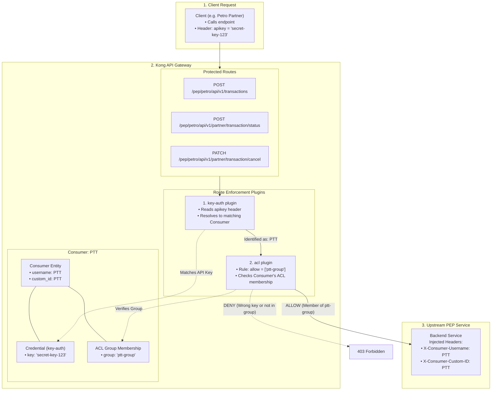

# Kong Partner Header (Go)

A Kong Gateway Go PDK plugin that sets the upstream request header `Partner` to the configured `partner_value`. It does not inspect or validate `x-devops-api-key`.

Requires self-managed Kong Gateway 3.4 or later. Kong's Go PDK runs as a plugin-server executable.

## Build

```sh
make build
```

For a local Kong container, build a Linux executable matching its architecture:

```sh
make build-kong
```

Override the architecture if needed, for example `make build-kong KONG_GOARCH=amd64`.

Install the binary in the Kong Gateway image or filesystem. Add the plugin server to `kong.conf`:

```ini
pluginserver_names = partner-header
pluginserver_partner_header_query_cmd = /usr/local/bin/partner-header -dump
plugins = bundled,partner-header
```

Restart or roll out Kong after installation. Enable `partner-header` on the intended Route or Service with the `partner_value` configuration field. Set the real partner identifier there; `XXX` is only a placeholder.

---

## Step-by-Step: Configure Routes & Bind Consumer (PTT)

You can execute these steps via `curl` below or directly with [kong-consumers.http](kong-consumers.http).

### Prerequisites: Port-Forward Kong Admin API
```sh
kubectl port-forward svc/<your-kong-admin-service> 8001:8001
```

---

### Step 1: Create Consumer `PTT`
Create the consumer with matching `username` and `custom_id`:

```sh
curl -i -X POST http://localhost:8001/consumers \
  -H "Content-Type: application/json" \
  -d '{
    "username": "PTT",
    "custom_id": "PTT"
  }'
```

---

### Step 2: Assign API Key Credential to Consumer
Generate or set the secret API key for consumer `PTT`:

```sh
curl -i -X POST http://localhost:8001/consumers/PTT/key-auth \
  -H "Content-Type: application/json" \
  -d '{
    "key": "your-secret-api-key-here"
  }'
```

---

### Step 3: Add Consumer to ACL Group
Add `PTT` to an ACL group (e.g., `ptt-group`):

```sh
curl -i -X POST http://localhost:8001/consumers/PTT/acls \
  -H "Content-Type: application/json" \
  -d '{
    "group": "ptt-group"
  }'
```

---

### Step 4: Create the Protected Routes

Create the route covering the Petro Partner endpoints:
- `POST /pep/petro/api/v1/transactions`
- `POST /pep/petro/api/v1/partner/transaction/status`
- `PATCH /pep/petro/api/v1/partner/transaction/cancel`

```sh
curl -i -X PUT http://localhost:8001/routes/pep-petro-partner-routes \
  -H "Content-Type: application/json" \
  -d '{
    "name": "pep-petro-partner-routes",
    "paths": [
      "/pep/petro/api/v1/transactions",
      "/pep/petro/api/v1/partner/transaction/status",
      "/pep/petro/api/v1/partner/transaction/cancel"
    ],
    "methods": ["POST", "PATCH"],
    "strip_path": false
  }'
```

---

### Step 5: Bind Authentication and ACL to the Route

1. **Enable `key-auth`** (identifies caller by API key):
   ```sh
   curl -i -X POST http://localhost:8001/routes/pep-petro-partner-routes/plugins \
     -H "Content-Type: application/json" \
     -d '{"name": "key-auth"}'
   ```

2. **Enable `acl`** (restricts access exclusively to `ptt-group`):
   ```sh
   curl -i -X POST http://localhost:8001/routes/pep-petro-partner-routes/plugins \
     -H "Content-Type: application/json" \
     -d '{
       "name": "acl",
       "config": {
         "allow": ["ptt-group"]
       }
     }'
   ```

---

### Step 6: Verify the Setup

1. **Authorized request (with PTT API key)**:
   ```sh
   curl -i -X POST http://localhost:8000/pep/petro/api/v1/transactions \
     -H "apikey: your-secret-api-key-here" \
     -H "Content-Type: application/json" \
     -d '{"amount": 100}'
   ```
   *Expected: HTTP 200 / Proxied upstream.*

2. **Unauthorized request (missing / invalid key)**:
   ```sh
   curl -i -X POST http://localhost:8000/pep/petro/api/v1/transactions
   ```
   *Expected: HTTP 401 Unauthorized / HTTP 403 Forbidden.*

---

## Architecture & Relation Diagram


